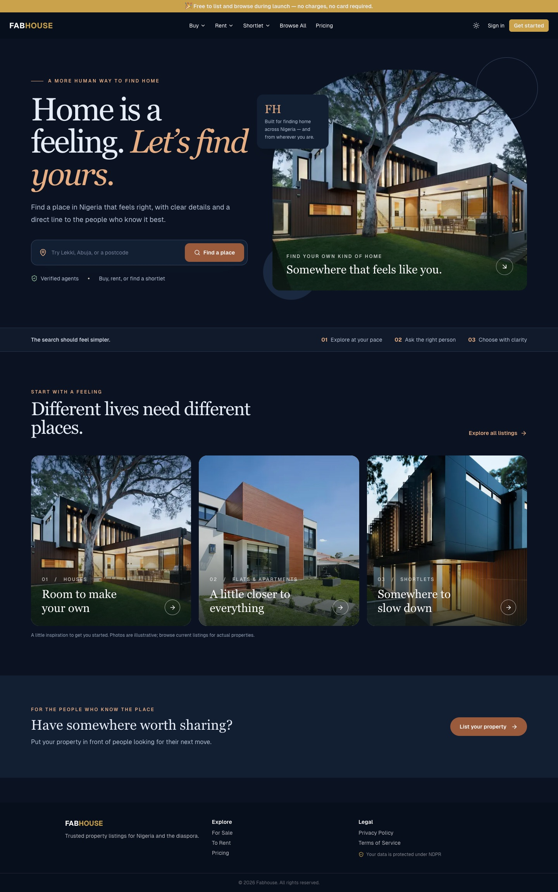

# Fabhouse

Fabhouse helps people browse properties to buy, rent, or request as short stays. Built with Next.js, TypeScript, MongoDB, NextAuth, and Tailwind CSS.

## Live site

[fabhouse-app.vercel.app](https://fabhouse-app.vercel.app/)

## Screenshots

<p align="center">
  
  
</p>

### Homes that feel like home

Illustrative property photos used in the homepage design. They are not active Fabhouse listings.

<p align="center">
  
  
  
</p>

Photos: [Unsplash image 1](https://images.unsplash.com/photo-1600585154340-be6161a56a0c), [image 2](https://images.unsplash.com/photo-1600047509807-ba8f99d2cdde), [image 3](https://images.unsplash.com/photo-1600585154526-990dced4db0d). Used under the [Unsplash License](https://unsplash.com/license).

## Getting started

```bash
npm install
cp .env.example .env.local   # fill in the required values, see below
npm run dev
```

Open http://localhost:3000.

### Required env vars (app won't work without these)
- `MONGODB_URI` — MongoDB Atlas connection string
- `NEXTAUTH_SECRET` — any random string (`openssl rand -base64 32`)
- `NEXTAUTH_URL` — `http://localhost:3000` locally, your real domain in production

### Optional env vars (features degrade gracefully without them)
- `NEXT_PUBLIC_CLOUDINARY_CLOUD_NAME` / `NEXT_PUBLIC_CLOUDINARY_UPLOAD_PRESET` — required for photo/video uploads. Configure a signed preset with allowed media formats and 10 MB photo / 100 MB video file-size limits; disable any old unsigned listing-upload preset.
- `CLOUDINARY_API_KEY` / `CLOUDINARY_API_SECRET` — server-side only; required to sign uploads, verify media before it can be attached to a listing, and delete removed assets. Without these, listing media uploads cannot be saved.
- `RESEND_API_KEY` — without this, emails (welcome, listing approved/rejected, inquiries, password reset) are logged to your terminal instead of sent. See `lib/email.ts`.
- `CRON_SECRET` — required in Vercel to authenticate the daily listing expiry job (`/api/cron/listing-expiry`). Set a private random value in the Vercel project environment variables; reminders also require `RESEND_API_KEY` to send.
- `PAYSTACK_SECRET_KEY` — only needed once `NEXT_PUBLIC_BILLING_ENABLED=true`. Configure `/api/billing/webhook` in Paystack; use `PAYSTACK_WEBHOOK_SECRET` if Paystack gives you a separate versioned signing secret (otherwise the endpoint supports the legacy signature using `PAYSTACK_SECRET_KEY`).

### Seed sample data (optional, for local testing)

Add these values to `.env.local` before running the seed script. Use two different passwords, each at least 12 characters long. The script refuses to run when `NODE_ENV=production`.

```bash
npm run seed
```

Creates:
- Admin login: `admin@fabhouse.ng` (password from `SEED_ADMIN_PASSWORD`)
- Agent login: `agent@fabhouse.ng` (password from `SEED_AGENT_PASSWORD`)
- A few sample listings (one pending, so you can test `/admin`)
- Two sample inquiries on the first active listing, so you can test `/dashboard/inquiries` and replying

### Run tests

```bash
npm run test:e2e
```

Playwright smoke tests covering homepage, browsing, pagination, registration, login, and password reset. Requires a running MongoDB pointed to by `MONGODB_URI`.

## How the site is organized

- `/` — homepage with search
- `/listings` — browse/filter listings, paginated (12 per page), partial/case-insensitive keyword search
- `/listings/[id]` — single property page; short-lets have date availability checks and signed-in guests can request a stay
- `/dashboard` — agent/developer's own listings, paginated, with edit/delete actions and inquiry counts
- `/dashboard/new` — post a new listing with photo upload
- `/dashboard/edit/[id]` — edit an existing listing (same form as new, pre-filled)
- `/dashboard/inquiries` — all inquiries across an agent's listings, with an inline reply box and requested dates/guest count for short-let enquiries
- `/dashboard/stays` — host calendar blocks, guest/host stay requests, accept/decline/cancel controls, and support-request status
- `/admin/stay-support` — triage stay support tickets and send a response by email
- `/dashboard/listings/expiry` — review and renew listings; a daily Vercel Cron sends expiry reminders, renews opted-in listings, archives expired listings, expires unpaid stay holds, and cleans up abandoned verification documents. Set `CRON_SECRET` and `RESEND_API_KEY` in Vercel to enable scheduled runs and email delivery. Existing active listings without expiry data get a 30-day grace period on the first run.
- `/admin` — admin-only overview for listing review, identity-verification requests, users, and audit history. Identity badges are granted through the review queue after an ID/CAC document is checked; they do not confirm property title or listing accuracy. Admins can suspend or unsuspend accounts; suspension blocks sign-in without deleting account data.
- `/pricing` — public pricing page
- `/billing/upgrade` — plan checkout via Paystack (inactive until billing is turned on)
- `/login` and `/register` — shared responsive auth layout with a property photograph, desktop split view, mobile welcome panel, accessible field labels, and browser autofill hints
- `/forgot-password`, `/reset-password` — password reset via emailed token link (expires in 1 hour)

## Markets

Listing and search localization is available for Nigeria, Ghana, Kenya, and South Africa. This does not mean Fabhouse has verified inventory or transaction support in every market; launches still need to be prepared city by city.

- Prices default to the selected market's currency. GBP and USD are available for some diaspora-priced listings.
- Price terms include options such as "Negotiable", "Offers Over", and "Guide Price".
- Land size is free text, so agents can enter local measures such as plots, hectares, or square metres.
- Tenure options include Nigerian terms such as C of O and Governor's Consent.

## First agent and admin accounts

For a local setup:

1. Register a normal account at `/register` with role **Agent** (or Developer) — this is your real, public-facing account that buyers will see and message.
2. Set up a separate **admin** account to review listings. Use `npm run seed` only for local testing; never use its default credentials in production.
3. In your agent account, open `/account`, upload an ID or CAC document, and submit it for review. An admin reviews it from the verification queue. The identity badge does not prove property ownership or listing accuracy.
4. After review, post listings from `/dashboard/new` and confirm their details and availability.

Admins cannot grant identity badges directly from the user list; badges follow the document-review flow. Admins also cannot suspend or change their own role from that screen, to avoid accidentally locking themselves out.

## Listing details

Listings now support the same core spec fields UK portals like Rightmove show:
- **Price qualifiers** — Fixed, Offers Over, Offers in Region of, Guide Price, or Price on Application (POA)
- **Price reduction tracking** — editing a listing to a lower price automatically stamps `priceReducedAt` and shows a "Reduced on DD/MM/YYYY" badge on the card and detail page
- **Size** — entered in sq ft, auto-converted and displayed in both sq ft and sq m
- **Tenure** — Freehold, Leasehold, or Nigeria-specific options (Governor's Consent, C of O)
- **Postcode** — separate field, included in the full address shown on the detail page
- **"Can you afford it?"** — a mortgage affordability calculator on the detail page (deposit %, rate, term, optional income check) for sale listings. It's a rough estimate with a disclaimer, not financial advice.
- **For Sale / To Rent** — direct header nav links, not just a filter dropdown

## Photos and videos

Agents can upload JPG, PNG, or WebP photos (up to 10 MB each) and MP4, MOV, or WebM walkthrough videos (up to 100 MB each, 3 per listing) through server-signed Cloudinary uploads into user-specific folders. Listing APIs verify the asset's Cloudinary location, media type, and size before saving it. Changing listing media sends the listing back to pending review; admin approval requires a manual review of all photos/videos. This moderation is not proof of property ownership or listing accuracy. Videos play inline on the detail page, with a "Video" badge on listing cards. Deleting or editing a listing cleans up removed videos from Cloudinary the same way it does for photos.

## Listing status

Admins approve or reject pending listings from `/admin`. After approval, owners can mark a listing active, sold, rented, or withdrawn from `/dashboard`. Inactive listings are excluded from search, and their detail pages no longer show contact or inquiry controls.

## Editing and deleting listings

When an agent removes a photo or video, or deletes a listing, Fabhouse also removes the affected Cloudinary assets when server credentials are configured.

## Inquiries and replies

Buyers send inquiries from a listing page. Fabhouse saves each message and emails it to the agent. Agents can reply from `/dashboard/inquiries`; replies go by email when the buyer provided an email address. If they only left a phone number, the agent can follow up by phone.

## Search

Search on `/listings` matches partial, case-insensitive text in titles, descriptions, and locations. For example, searching `lekk` can find "Lekki".

## Billing

Agent billing is off by default in `config/features.ts`, so accounts use the unrestricted launch plan. Paystack checkout and webhook handling are implemented but remain gated. Nigeria's prices are still drafts; validate prices and support/refund policies with agents before enabling billing. Payments are one-time and grant one month of access.

## Privacy and legal review

- **`/privacy` and `/terms`** describe how the app handles user data and transactions. They are drafts and need review by qualified local counsel before launch in each market.
- **Consent at registration** — signup requires explicitly agreeing to the Privacy Policy and Terms; this is enforced server-side (`consent: true` required by the API, not just a UI checkbox), and the acceptance is timestamped on the user record (`consentedToTermsAt`).
- **Professional identity documents** — new ID/CAC uploads use Cloudinary authenticated storage and are deleted after the admin decision. Admin access uses a short-lived signed document link. The badge is described as an identity check; it does not verify property title or every listing claim.
- **`/account`** — self-service page for account data rights:
  - **Download my data** (`/api/account/export`) — JSON export of account, listings, sent/received inquiries, saved searches, written reviews, stay requests/support tickets, and plan-payment records; authentication secrets and private verification-document links are excluded.
  - **Delete my account** (`/api/account/delete`) — removes the account, listings, hosted media, related inquiries, saved searches, reviews, unpaid stay requests, and related support tickets. Password accounts re-enter their password; Google accounts confirm from their active signed-in session.
- **Footer** — links to Privacy/Terms and a data-protection note on every page.

Data export and deletion do not, on their own, establish legal compliance. Have counsel review the policies and data practices for each launch market.

## More features

**WhatsApp inquiries** — buyers can open a pre-filled WhatsApp message from a property's detail page.

**Map view** — switch between grid and map on `/listings`. New or updated addresses are geocoded with OpenStreetMap Nominatim; a geocoding failure won't block a listing from saving.

**Link previews** — listing pages include Open Graph metadata for sharing.

**Sitemap and robots.txt** — `/sitemap.xml` includes active listings and public pages. Private dashboard, admin, account, and API routes are excluded from crawling.

**Image optimization** — public listing images use `next/image`.

**Agent profiles** — `/agents/[id]` shows an agent's verification status and listings.

**Saved listings** — signed-in users can bookmark properties and view them at `/saved`.

**Recommendations** — signed-in users see active listings similar to the places they save, matched by market, location, property type, and price.

**Saved search alerts** — save filters on `/listings` and get an email when a matching listing is approved. Manage alerts at `/saved-searches`.

**Agent verification** — agents and developers can submit ID or CAC documents from `/account`; admins review them at `/admin/verifications`.

## Limitations

- Nominatim has a fair-use policy. Consider another geocoder if listing volume grows.
- Older listings may not have map coordinates until their address is updated.
- Search alert emails are sent individually when a listing is approved.
- Verification is a manual document review, not automated identity or property-title verification.

## Search and admin

**Local-currency search** — price filters compare listings in the selected currency. GBP and USD are also available for eligible listings.

**Audit log** — review admin changes at `/admin/audit-log`.

**Admin dashboard** — `/admin` summarizes listings awaiting review, verification requests, user counts, and listing statuses. The review queue is at `/admin/pending`.

## Account security

- Passwords are hashed with bcryptjs. Sessions use signed JWTs through NextAuth.
- Suspended accounts are blocked during sign-in.

## Rate limiting

MongoDB-backed (not in-memory, so it survives serverless cold starts) via `lib/rateLimit.ts`:
- Registration: 8 accounts per IP per hour
- Inquiries: 5 messages per IP per 10 minutes
- Forgot-password requests: 5 per IP per hour

## Deployment

1. Create a MongoDB Atlas database and set `MONGODB_URI`.
2. Import the GitHub repository into Vercel and add the environment variables from `.env.local`.
3. Set `NEXTAUTH_URL` to the production URL and redeploy.
4. Create an admin account through the approved production setup process. Do not leave the seed credentials in use.

## Still to build

- **Market rollout:** confirm inventory and support in each city before launch.
- **Short-let stays have a pre-payment request flow only.** Hosts can block dates; guests can see blocked/held dates and request a stay; host acceptance places a 24-hour unpaid hold; either party can cancel before payment. These are requests and unpaid holds, not confirmed bookings. Stay checkout, paid cancellation/refund handling, and host payouts are not implemented.
- Paid stays are not bookings yet: checkout, paid cancellations/refunds, and host payouts are not implemented. See the [market launch checklist](docs/market-launch-readiness.md) before considering a paid pilot.
- Agent billing is disabled. Nigeria's plan prices are drafts and need agent interviews; confirm pricing and featured-listing limits before enabling it.
- Configure the production Cloudinary signed upload preset and disable the old unsigned preset.
- Build the diaspora campaign page.
- Have local counsel review the terms and privacy pages, and assign support coverage, before launch in each market.
